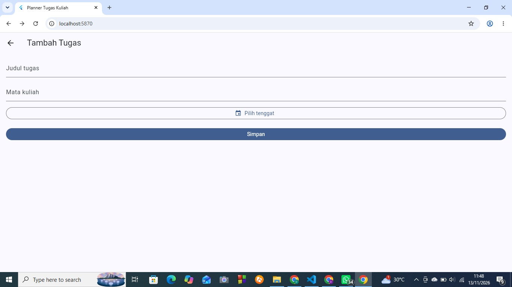
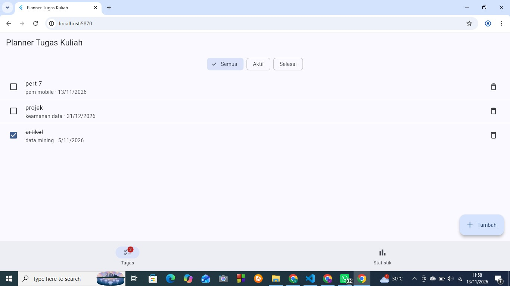
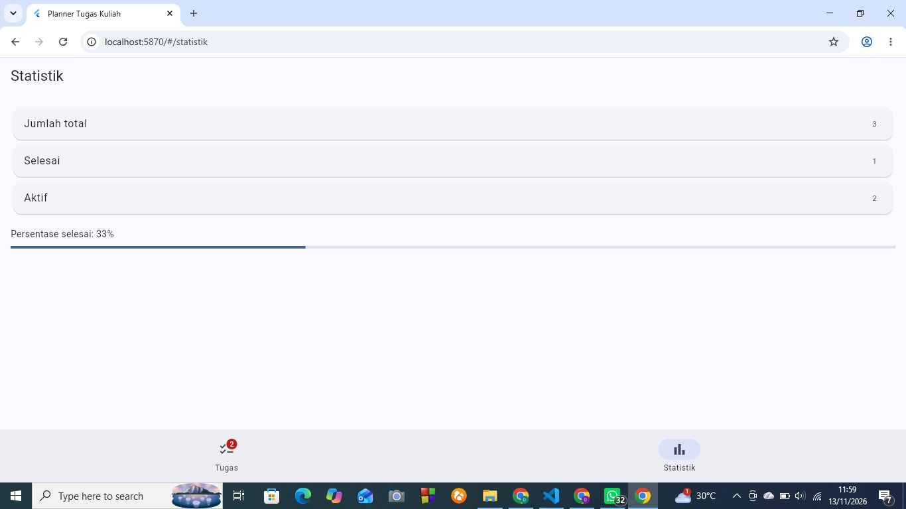

# Planner Tugas Kuliah

## Identitas
- Nama: Dea Anggraini
- NIM: 4243250051
- Mata Kuliah: Pemrograman Mobile (3KOM40215)

## Tangkapan Layar

## Letak State

    PlannerApp
    └─ ChangeNotifierProvider<TugasModel>   <- state BERSAMA (daftar tugas)
       ├─ HalamanDaftar   (_filter = state LOKAL, setState)
       ├─ HalamanForm     (controller + tenggat = state LOKAL, initState/dispose)
       ├─ HalamanStatistik (membaca model dengan watch)
       └─ KerangkaNavigasi (badge dengan select)

Alasan: daftar tugas dipakai tiga tempat (daftar, statistik, badge) sehingga harus
bersama. Filter dan isi form hanya dipakai satu halaman sehingga cukup lokal.

## Penjelasan Lifecycle dan Pilihan Provider
Pada halaman form saya memakai StatefulWidget karena ada dua TextEditingController dan tanggal tenggat yang berubah-ubah. Kedua controller saya buat di initState supaya hanya dibuat sekali, yaitu saat State pertama kali dibuat. Kalau dibuat di build(), controller ikut dibuat ulang setiap layar digambar dan teks yang sedang diketik bisa hilang. Di dispose(), kedua controller saya buang. Kalau tidak, objeknya tetap tersimpan di memori setelah halaman ditutup (memory leak). Setelah await showDatePicker, saya memeriksa if (!mounted) return; karena halaman bisa saja sudah ditutup saat kalender dipilih, dan memanggil setState pada widget yang sudah tidak ada akan menimbulkan error.

Filter Semua/Aktif/Selesai saya simpan dengan setState karena hanya dipakai satu halaman. Daftar tugas dipakai halaman daftar, statistik, dan badge di navigasi, jadi saya taruh di TugasModel dan disediakan lewat Provider. Saya memilih Provider karena lebih ringkas daripada Cubit untuk aplikasi sekecil ini. Cukup satu kelas ChangeNotifier dan notifyListeners(), lalu badge memakai select sehingga hanya dibangun ulang saat jumlah tugas aktif berubah. Modelnya juga mudah diuji tanpa UI. Karena sudah mencoba keduanya di praktikum keranjang, saya merasa Provider lebih cepat dikerjakan untuk tugas ini. Kalau aplikasinya makin besar atau dikerjakan banyak orang, saya akan mempertimbangkan Cubit.

## Pernyataan Penggunaan AI
Saya menggunakan AI sebagai pendamping belajar selama praktikum dan tugas ini. Bantuannya mencakup menjelaskan langkah pengerjaan, membuat kerangka kode awal, dan membantu mencari penyebab error. Seluruh kode saya jalankan dan uji sendiri (flutter analyze dan flutter test).